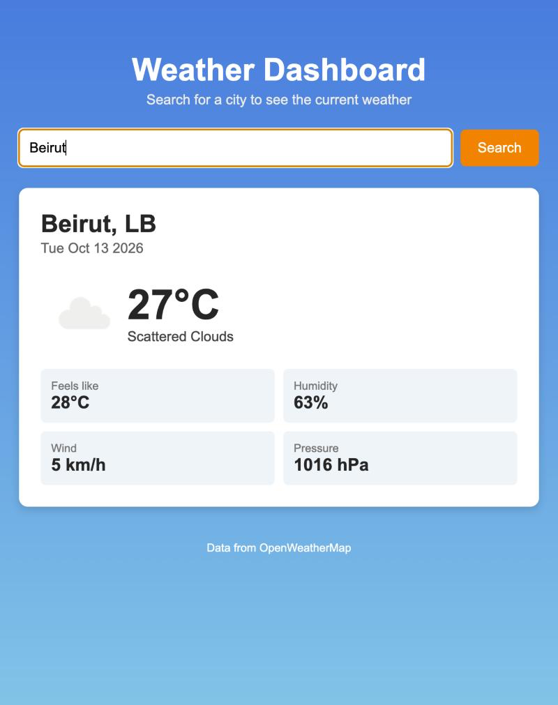

# Weather Dashboard

Assignment 4 - a simple weather dashboard that shows the current weather for any city using the [OpenWeatherMap](https://openweathermap.org/) API.

## Features

- Search for any city by name
- Shows temperature, weather description and icon
- Also shows feels like, humidity, wind speed and pressure
- Loading spinner while the data is being fetched
- Error messages for things like misspelled cities, a bad API key, too many requests or no internet
- Works on mobile and desktop

## Setup

### 1. Get an API key

1. Make a free account at https://home.openweathermap.org/users/sign_up
2. Go to the **API keys** tab on your account page and copy your key (there's a default one already made)
3. **Note:** new keys can take up to 1-2 hours to activate. Until then you'll get an "Invalid API key" error.

### 2. Add the key to the project

The key is **not** included in this repo. To add yours:

1. Make a copy of `config.example.js` and name it `config.js`
2. Open `config.js` and replace `YOUR_API_KEY_HERE` with your key:

```js
const CONFIG = {
  API_KEY: "abc123yourkeyhere"
};
```

`config.js` is listed in `.gitignore` so it won't get committed.

(Because this is a frontend-only app the key can still be seen in the browser's network tab when the page runs. That's normal for a project like this. The point is just to keep it out of the repo.)

### 3. Run it

Open `index.html` in a browser. Using the VS Code Live Server extension also works.

## Files

```
index.html          - page layout
style.css           - styling + mobile layout
script.js           - fetch logic, rendering, loading/error states
config.example.js   - template for the API key
config.js           - your actual key (not in the repo)
```

## How it works

When you search, `script.js` calls the OpenWeatherMap current weather endpoint with `fetch` using `async/await`. The request is inside a `try/catch`, and any response that isn't OK is checked by status code (404 = city not found, 401 = bad key, 429 = rate limit) so the user sees a proper message and nothing crashes. The search button is disabled while a request is running.

## Screenshot


